<div align="center">



# DrakesPurpur · Horizon Hybrid Engine

**Un unico motor Java + Rust para DrakesCraft: Purpur 26.2 con backend nativo Rust integrado (FFM, biblioteca embebida en el JAR), pipeline de chunks instrumentado, DrakesLOD en investigacion y compatibilidad verificada con Slimefun y las StarSuites.**

<p>
  
  
  
  
  
</p>

</div>

> **Un solo producto, un solo proceso, una sola autoridad del mundo.** Rust no es un servidor aparte: es una biblioteca nativa que va **dentro del JAR**, se extrae por plataforma, se verifica por SHA-256 y se carga sola; si falta o falla, todo sigue en Java.
>
> **Estado honesto.** Esta rama (`experimental/horizon-rust-hybrid-engine`, PR #1, borrador) integra un puente Java↔Rust real y comprobado, pero **ninguna aceleracion nativa ha demostrado hoy una mejora de rendimiento** frente a Java. Todo lo experimental esta **apagado por defecto**. No esta lista para produccion. Ver [Benchmarks verificados](#benchmarks-verificados) y [Limitaciones](#limitaciones).
> El README del monolito de produccion se conserva integro en [`docs/README_MONOLITO.md`](docs/README_MONOLITO.md).

## Que es

DrakesPurpur es el fork de [Purpur](https://github.com/PurpurMC/Purpur) (sobre Paper) que ejecuta DrakesCraft: kernel propio, 9 StarSuites embebidas y Slimefun sobre un nucleo nativo. El **Hybrid Engine** anade, de forma modular y desactivable:

- un puente **Java 25 ↔ Rust** por FFM (Panama) con **ABI versionada**, buffers prestados (sin copias, sin memoria que Java deba liberar) y **fallback automatico a Java**;
- enganches en el pipeline real de chunks (parche `0023`, `PalettedContainer`) y un **evaluador nativo de ruido** (`NormalNoise`) con paridad bit a bit demostrada;
- **instrumentacion** del recorrido de chunks (generar, guardar, cargar, preparar envio) y un autotest dentro del servidor real;
- **prefetch direccional** experimental de chunks para quien se desplaza rapido (Elytra/vuelo);
- administracion in-game: **`/drakes hybrid`** y un panel (GUI) con datos reales;
- un **auditor de catalogo** de Slimefun y un servidor de pruebas de compatibilidad en CI.

**Principio de diseno:** Java sigue siendo la unica autoridad del mundo. Rust solo calcula sobre buffers prestados durante una llamada; nunca abre archivos de region ni guarda punteros. No hay dos simulaciones.

## Motor unificado: que significa aqui (y que no)

| Propiedad | Estado |
|---|---|
| Un unico JAR / proceso / mundo / configuracion (`drakes-data/perf.yml`) / logs / administracion (`/drakes hybrid`) | **Implementado** |
| Biblioteca nativa embebida en el JAR, extraida y verificada (SHA-256) automaticamente | **Implementado** (`scripts/empaquetar_nativos.sh` + `DRAKES_BUNDLE=1`); solo **Linux x86_64** construida y probada |
| Deteccion de plataforma, comprobacion de ABI, fallback Java, trazabilidad de fallos | **Implementado** |
| Interruptor unico `hybrid.engine.enabled` | **Implementado**; **`false` por defecto** hasta cumplir [`CRITERIOS_ESTABLE.md`](docs/hybrid/CRITERIOS_ESTABLE.md) (hoy ninguna aceleracion demuestra mejora) |
| Capacidades de Horizon como componentes de primera clase | **Parcial:** diseno e investigacion + codec `horizon:lod`; los kernels portados no superan a Java |
| DrakesLOD (terreno lejano para clientes Horizon) | **Investigado; codec probado; backend NO conectado** ([`DRAKES_LOD.md`](docs/hybrid/DRAKES_LOD.md)) |

## Arquitectura

```
 Paper/Purpur (Java 25)                          libdrakes_hybrid_ffi (Rust, ABI 1)
 ─────────────────────                          ─────────────────────────────────
 PalettedContainer ──► HybridChunkOps ─┐
 (parche 0023)                          ├─► HybridNative ──FFM──►  bitstorage · noise · density(NormalNoise) · region
 HybridDensity (export de tablas)  ─────┘     │  (critical, heap)      (funciones puras, sin estado global)
                                               └─ fallback Java (misma semantica) si: apagado · sin biblioteca · ABI distinta
                                                  · lote pequeno · error nativo (la ruta se apaga hasta reiniciar)
 HybridChunkPrefetch ─ World#getChunkAtAsync (API publica de Paper, asincrono, con presupuesto)
 HybridEvents · HybridStats · HybridAdmin · HybridAdminMenu · HybridSelfTest
```

Detalle y decisiones (opciones A–D, por que no hay dos escritores): [`docs/hybrid/ARQUITECTURA.md`](docs/hybrid/ARQUITECTURA.md).

## Compatibilidad

| | Estado | Fuente |
|---|---|---|
| Bukkit / Paper / Purpur | Build completo en CI (`applyAllPatches`, `build`, `createPaperclipJar`, `scanJarForBadCalls`) | CI |
| Slimefun (`Slimefun4-Drake@port-26x`) + 9 modulos de StarSuites con Hybrid ON | Cargan; ida y vuelta de items, `BlockStorage` y **persistencia tras reinicio** verificados | [`COMPATIBILIDAD.md`](docs/hybrid/COMPATIBILIDAD.md) |
| Maquinas en ejecucion, GUIs de Slimefun, bosses, Geyser/Bedrock, SAORI/Profiler | **No verificado** | idem |
| Horizon Client 26.3 → servidor 26.2 | Investigado (el cliente trae adaptador 26.2); **no probado** | [`CLIENTE_HORIZON.md`](docs/hybrid/CLIENTE_HORIZON.md) |
| Fabric / Forge / NeoForge | No se promete | - |

El numero de items de Slimefun depende de lo que se cargue: el servidor de pruebas minimo registra una fraccion del ecosistema de produccion (volcado de referencia: 15.986 items, 64 addons). Ver el auditor: [`docs/hybrid/CATALOGO_SLIMEFUN.md`](docs/hybrid/CATALOGO_SLIMEFUN.md).

## Funcionalidades

**Integradas y verificadas** (apagadas por defecto): puente FFM con fallback · enganche de bit-packing en `PalettedContainer` (paridad NBT exacta) · evaluador `NormalNoise` (paridad bit a bit) · instrumentacion y autotest · comandos y GUI · auditor de catalogo · workflows de CI.

**Experimentales / sin ganancia demostrada**: aceleracion nativa de bits y ruido (dentro del ruido de medida) · prefetch direccional de chunks (ver benchmarks).

**No implementadas**: port del grafo completo de density functions · backend DrakesLOD conectado · cache del paquete de chunk (idea de Horizon, ver [`HORIZON_PIPELINE.md`](docs/hybrid/HORIZON_PIPELINE.md)) · launcher propio (DrakesRust) · pruebas con Horizon Client · plataformas nativas distintas de Linux x86_64.

## Requisitos

JDK 25 · Linux x86_64 (unica plataforma nativa construida y probada) · `cargo` (Rust estable) solo para compilar la biblioteca · Gradle del repositorio (`./gradlew`).

## Compilacion

```bash
git clone https://github.com/SlimefunNewHorizons/DrakesPurpur && cd DrakesPurpur
git checkout experimental/horizon-rust-hybrid-engine
git config user.name "tu-nombre" && git config user.email "tu@correo"
./gradlew applyAllPatches
./gradlew createPaperclipJar            # purpur-server/build/libs/*paperclip*.jar
( cd native/drakes-hybrid && cargo build --release )   # target/release/libdrakes_hybrid_ffi.so
scripts/hybrid-check.sh --bench         # paridad Java/Rust + microbenchmark (JDK 25)
sha256sum purpur-server/build/libs/*paperclip*.jar native/drakes-hybrid/target/release/libdrakes_hybrid_ffi.so
```

El **JAR** (servidor) y la **biblioteca nativa** son artefactos separados: el JAR funciona solo (modo Java); la biblioteca es opcional. Los artefactos de cada ejecucion de CI se publican en las pestañas *Actions* (`hybrid-selftest`, `hybrid-compat-catalog`).

## Instalacion

1. Copia el JAR a una carpeta nueva, acepta `eula.txt` y arranca con `--enable-native-access=ALL-UNNAMED`.
2. La biblioteca nativa puede ir **embebida** (JAR construido con `scripts/empaquetar_nativos.sh` y `DRAKES_BUNDLE=1`: se extrae sola) o como archivo externo en `natives/` (tambien `drakes-data/natives`, `-Ddrakes.native.dir`, `$DRAKES_NATIVE_DIR`; lo externo tiene prioridad).
3. En `drakes-data/perf.yml` activa **solo lo que quieras probar** (ver abajo) y reinicia.
4. Usa `/drakes hybrid status` para comprobar biblioteca, ABI y modo.

**Rollback:** `native.hybrid.enabled: false` (o retira la biblioteca) y reinicia. El parche delega al codigo original de Mojang; el formato de disco es identico (no hay migracion).

## Configuracion (`drakes-data/perf.yml`)

```yaml
hybrid:
  engine:
    enabled: false      # interruptor unico del motor (true solo tras cumplir CRITERIOS_ESTABLE.md; o -Ddrakes.hybrid.engine.enabled=true en pruebas)
native:
  hybrid:
    enabled: false      # (compatibilidad) equivale a hybrid.engine.enabled
    min-batch: 2048     # bajo este tamano se usa Java
    bits: false         # SimpleBitStorage por lotes
    noise: false        # reservado; sin ganancia demostrada
    region: false       # analisis solo lectura de cabeceras .mca
    stats: false        # contadores por etapa
    prefetch:           # EXPERIMENTAL
      enabled: false
      min-speed: 20.0   # bloques/s
      lead-seconds: 3.0
      max-lookahead-chunks: 8
      half-width-chunks: 2
      max-in-flight: 24
```

## Comandos

Permiso `drakes.hybrid.admin` (operadores por defecto). Con autocompletado.

| Comando | Muestra |
|---|---|
| `/drakes hybrid status` | biblioteca, ABI, modo, aceleraciones, fallback, TPS/MSPT |
| `/drakes hybrid info` | configuracion efectiva |
| `/drakes hybrid chunks` | chunks por mundo, cargas nuevas/existentes, envios, prefetch |
| `/drakes hybrid workers` | hilos por familia y estado, CPU |
| `/drakes hybrid benchmark [confirm]` | microbenchmark sintetico (no toca mundos) |
| `/drakes hybrid diagnostics` | errores nativos, JVM, GC, compatibilidad, etapas |
| `/drakes hybrid gui` | panel in-game |

## GUI

Panel de 27 slots con **datos leidos al abrir** (sin metricas simuladas). Los unicos controles son reales: conmutar en caliente la ruta nativa de bits y el prefetch (doble clic en 5 s, **solo la sesion**; lo persistente es `perf.yml` + reinicio). *Los clics de la GUI no se han probado con un jugador real; los comandos y la construccion del inventario si estan cubiertos por el autotest.*

## Benchmarks verificados

Entorno: GitHub Actions (4 vCPU compartidas), servidor real compilado de esta rama. Variabilidad del control Java entre corridas: 12–23 %. Detalle, metodo y limites: [`docs/hybrid/RESULTADOS.md`](docs/hybrid/RESULTADOS.md).

| Medicion | Resultado |
|---|---|
| Bit-packing (guardado/carga de secciones) | paridad NBT exacta (13.872 contenedores reales); velocidad ×1,00–1,07: **sin mejora demostrable** |
| `NormalNoise` nativo | paridad **bit a bit** (3 ruidos × 200.000 puntos); velocidad ×0,98–1,21: **sin mejora demostrable** |
| Donde va el tiempo | generar un chunk nuevo ≈ 38–60 ms; guardarlo ≈ 0,3–0,5 ms; preparar su paquete ≈ 0,03–0,07 ms |
| Prefetch direccional / volador sintetico | **peor** que reactivo a 24/40/64 b/s (64 % vs 26 % de columnas tarde a 24 b/s); desactivado por defecto — ver `RESULTADOS.md` (fase 4/5) |

## Estado de Slimefun y StarSuites

Con Hybrid ON, Slimefun y 9 modulos de StarSuites cargan sin excepciones; 123/123 comprobaciones de identidad de items y `BlockStorage`; persistencia tras reinicio correcta. **No** se han probado maquinas en ejecucion, GUIs, bosses ni jugadores. `drakes-onechunk` es un **addon de BentoBox** (se instala en `plugins/BentoBox/addons/`, no en `plugins/`).

## Limitaciones

[`docs/hybrid/LIMITACIONES.md`](docs/hybrid/LIMITACIONES.md): sin ganancia de rendimiento demostrada, port de density functions no realizado, sin pruebas con Horizon Client, solo Linux x86_64, GUI no probada con jugadores, benchmarks en hardware compartido.

## Criterios para dejar de ser experimental

Lista objetiva de 12 criterios (build, paridad, regresion, concurrencia, persistencia, compatibilidad de plugins, benchmarks repetibles, **mejora demostrada**, jugadores, recuperacion, rollback, estabilidad prolongada) y estado por componente en [`CRITERIOS_ESTABLE.md`](docs/hybrid/CRITERIOS_ESTABLE.md). **Hoy ningun componente cumple la mejora demostrada**, por eso el motor sigue desactivado por defecto.

## Roadmap

1. Medir la carga real con jugadores/bots y hardware dedicado; decidir el prefetch con intervalos de confianza.
2. Accesores por parche en lugar de reflexion (`HybridDensity`).
3. Evaluador de density functions por lotes **solo si** un perfil demuestra ganancia a nivel de chunk.
4. Bibliotecas nativas para mas plataformas, con pruebas.
5. Pruebas funcionales profundas de Slimefun/StarSuites (maquinas, redes, GUIs, bosses) y de Horizon Client.
6. Launcher propio basado en Horizon (idea de producto; fuera de esta rama).

## Documentacion

[`docs/hybrid/`](docs/hybrid/README.md) · [Arquitectura](docs/hybrid/ARQUITECTURA.md) · [Componentes de Horizon](docs/hybrid/HORIZON_COMPONENTS.md) · [Resultados](docs/hybrid/RESULTADOS.md) · [Compatibilidad](docs/hybrid/COMPATIBILIDAD.md) · [Catalogo Slimefun](docs/hybrid/CATALOGO_SLIMEFUN.md) · [Horizon Client](docs/hybrid/CLIENTE_HORIZON.md) · [DrakesLOD](docs/hybrid/DRAKES_LOD.md) · [Horizon vs Paper](docs/hybrid/HORIZON_PIPELINE.md) · [Criterios de estabilidad](docs/hybrid/CRITERIOS_ESTABLE.md) · [Despliegue](docs/hybrid/DESPLIEGUE.md) · [Limitaciones](docs/hybrid/LIMITACIONES.md) · [Instalacion del motor](docs/INSTALACION_MOTOR.md) · [Monolito](docs/MONOLITO.md)

## Licencias y creditos

- DrakesPurpur: GPL-3.0 (ver `LICENSE`); fork de **Purpur** y **Paper** (PaperMC) y, por tanto, de Mojang/Minecraft sin afiliacion.
- **Horizon** (`horizon-rust/horizon`, MIT, © 2026 Ludovic Marie and the Horizon contributors): usado como referencia de diseno y para investigacion de protocolo. **No se copio codigo de Horizon** en esta rama; el registro esta en [`HORIZON_COMPONENTS.md`](docs/hybrid/HORIZON_COMPONENTS.md).
- **Slimefun** (TheBusyBiscuit y comunidad), **Slimefun4-Drake**, **Drakes-Suites** y **Slimefun-Knowledge-Drake** (volcado de referencia): proyectos del ecosistema de JackStar6677-1 / SlimefunNewHorizons; usados solo en lectura.
- Autoria del kernel y las StarSuites: **Jack (JackStar6677-1)**; Suite Multiverse: **Chagui68**. Ver `/drakes credits` y `NOTICE`.
- Banner SVG: obra original de este repositorio (sin logos protegidos).
