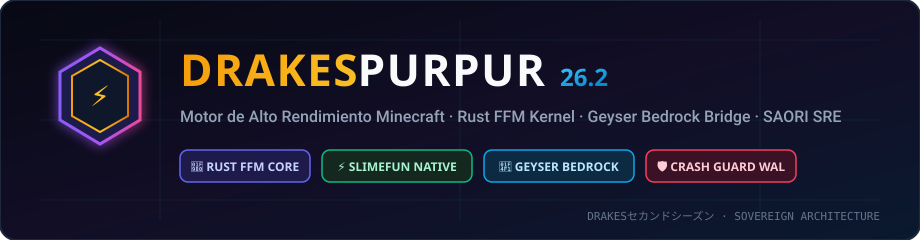

<div align="center">

  

# ⚡ DrakesPurpur 26.2

**El Motor Soberano de Alto Rendimiento de Minecraft para DrakesCraft y la Segunda Temporada**

<p>
  <a href="https://github.com/SlimefunNewHorizons/DrakesPurpur"></a>
  
  
  
  
</p>

</div>

> ### 🏰 ¡Únete a la Comunidad Oficial de DrakesCraft!
> 
> * 🎮 **IP del Servidor**: `mc.drakescraft.cl` *(Java 26.2 & Bedrock)*
> * 💬 **Discord Oficial**: [discord.gg/drakescraft](https://discord.gg/rv3vtXZTk7)
> * 🌐 **Web & Guía Oficial**: [web.drakescraft.cl](https://web.drakescraft.cl) — 🛒 **Tienda Oficial**: [web.drakescraft.cl/store](https://web.drakescraft.cl/store.html)
> 
> *DrakesPurpur es el núcleo nativo que impulsa la Segunda Temporada de DrakesCraft con más de 80 expansiones de Slimefun, economía dinámica, modalidades aisladas y 20.0 TPS constantes.*

---

## 🎯 Misión & Filosofía de DrakesPurpur

Los servidores de Minecraft con mods y addons técnicos masivos (como Slimefun y redes logísticas) históricamente colapsan debido a la saturación del Garbage Collector de la JVM y el overhead de miles de eventos de Bukkit disparándose cada segundo.

**DrakesPurpur** nace como un fork soberano de [PurpurMC/Purpur](https://github.com/PurpurMC/Purpur) diseñado con un objetivo claro:  
**Transformar Minecraft en un motor técnico ultra-eficiente, blindado contra crasheos y perfectamente coordinado con inteligencia autónoma SRE (SAORI) y jugadores de Bedrock (Geyser).**

---

## ⚡ Pilares de Innovación Arquitectónica

### 1. 🛡️ Kernel Crash Guard & Auto-Cicatrización (CERO Crasheos)
- Intercepta excepciones no controladas (`NullPointerException`, `IndexOutOfBoundsException`, `ConcurrentModificationException`) en el bucle principal de tikeo (`ServerTick` y `BlockEntityTick`).
- **Aislamiento Seguro:** Si una máquina o entidad de un plugin arroja un fallo crítico, el motor la desactiva y registra el incidente en **SQLite WAL (`drakes_faults.db`)**, impidiendo que el servidor se caiga. Los jugadores siguen jugando a 20.0 TPS sin interrupciones.

### 2. 🦀 Enlace Nativo Rust Off-Heap (Java 25 Panama FFM)
- **El Verdadero Cuello de Botella de Minecraft:** En servidores masivos con más de 80 addons de Slimefun, el problema nunca ha sido la velocidad de cálculo de la CPU, sino los **millones de objetos Java efímeros** que saturan el Garbage Collector, provocando micro-congelamientos (*Stop-The-World GC Pauses*).
- **Por qué NO reescribir 200 repositorios a Rust/C:** Reescribir años de código Bukkit/Paper en Rust desde cero es inviable e innecesario. El modelo pragmático es **híbrido**: Java sigue ejecutando el juego, los eventos y los plugins, mientras que **Rust maneja la memoria pura off-heap** a través de la API estándar **Panama FFM (Foreign Function & Memory)** sin la sobrecarga del JNI clásico.
- **Pre-carga en el Kernel:** Carga en el arranque del servidor [`libslimefun_ffi.so`](natives/libslimefun_ffi.so).
- Las redes eléctricas de Slimefun, transferencias cuánticas y simulaciones continuas se computan fuera del Heap de Java en memoria nativa con paralelismo real (AVX-512 VNNI), liberando gigabytes de memoria del GC (G1GC) y garantizando 20.0 TPS clavados.

### 3. 📱 Geyser & Bedrock Companion Engine (Optimización Móvil)
- **Compensación de Redundancia de Paquetes:** Reduce la tasa de actualización de entidades irrelevantes para clientes móviles con ancho de banda limitado.
- **Manejo Seguro de Coordenadas & Vacío:** Erradica muertes fantasma en el vacío del End/Skyblock mediante reubicación predictiva (`teleport-if-outside-border`).
- **Ping / Keepalive Desacoplado:** Sistema alternativo de keepalive que evita expulsiones injustificadas de jugadores de consolas o celulares con alta latencia.

### 4. 🤖 SAORI Kernel Bridge Directo (Adiós a DiscordSRV & Logs)
- El motor incorpora un canal IPC / Socket directo de baja latencia con el daemon de **SAORI** (`saori-ai-daemon` en el puerto 8089).
- Reemplaza por completo el scraping de archivos de texto (`latest.log`) y elimina la necesidad de plugins pesados de Discord.
- Telemetría en tiempo real, chat bidireccional instantáneo entre Discord y Minecraft, y monitoreo SRE automatizado.

### 5. 🔬 Rama Experimental: Slimefun Native Monolith (`feat/slimefun-native-engine`)
- En paralelo al soporte de suites modulares (`StarSuites`), desarrollamos la absorción nativa de Slimefun dentro del propio código de Minecraft:
  - Los bloques custom de Slimefun son tratados como `Block` nativo de Minecraft, eliminando el overhead de wrappers y NBT tags en PDC.
  - Generación de un único ejecutable `DrakesPurpur-Server.jar` que levanta Minecraft con Slimefun integrado de fábrica.

---

## 🛠️ Pipeline de CI/CD & Auto-Deploy

DrakesPurpur está conectado a un pipeline de **GitHub Actions** ([`.github/workflows/drakes_ci_cd.yml`](.github/workflows/drakes_ci_cd.yml)):
1. **Compilación en la Nube:** Cada `git push` a `ver/**` compila automáticamente el ejecutable Paperclip usando Java 25 y el sistema de parches Paperweight.
2. **Entrega a SAORI:** El artefacto compilado se transfiere a staging mediante webhooks seguros, permitiendo aplicar actualizaciones en el servidor en el próximo reinicio programado sin tocar la terminal.

---

## 📜 Instrucciones de Compilación Local

Para compilar el proyecto en local sobre Linux:

```bash
# Requiere Java 25 LTS configurado en JAVA_HOME
./gradlew applyAllPatches
./gradlew createReobfPaperclipJar -Dorg.gradle.parallel=false
```

El binario resultante se generará en `build/libs/DrakesPurpur-26.2-paperclip.jar`.

---

## 🙏 Reconocimientos & Upstream Attribution

DrakesPurpur es un fork soberano creado y mantenido por [**JackStar6677-1**](https://github.com/JackStar6677-1) bajo la infraestructura de **DrakesCraft Labs** y **Star Systems**.

Expresamos nuestro profundo agradecimiento a los gigantes sobre cuyos hombros se construye este proyecto:
- **[PurpurMC](https://github.com/PurpurMC/Purpur):** Por crear el fork más configurable y divertido de Minecraft.
- **[PaperMC](https://github.com/PaperMC/Paper):** Por revolucionar el rendimiento, el sistema de parches Paperweight y la API moderna de Bukkit.
- **[GeyserMC](https://geysermc.org/):** Por tender el puente que une a los jugadores de Bedrock y Java en un solo mundo.
- **[TheBusyBiscuit](https://github.com/TheBusyBiscuit):** Por la creación original de Slimefun4, base de la supervivencia técnica moderna.
- **[SpigotMC](https://www.spigotmc.org/) & [Mojang Studios](https://www.minecraft.net/):** Por el universo de Minecraft.

---

<div align="center">

**DrakesCraft Labs · Star Systems** · Diseñado por [**JackStar6677-1**](https://github.com/JackStar6677-1)  
*Arquitectura Soberana de Software para la Segunda Temporada*

</div>
