<div align="center">

  

# DrakesPurpur: Slimefun Native Engine Monolith
### `feat/slimefun-native-engine` - Experimental Next-Gen R&D Branch

<p>
  
  
  
  
</p>

</div>

---

## Vision: The World's First Native Slimefun Server Engine

Historically, technical modded Minecraft servers are fractured into two conflicting paradigms:
1. **Bukkit Plugin Layers:** High compatibility, but plagued by `PluginClassLoader` indirection, PDC serialization overhead, and redundant Bukkit event queues.
2. **Total Re-implementations (Rust/C):** Impressive raw speeds, but incompatible with 200+ existing Java plugins, Spigot APIs, and community addons.

The **Slimefun Native Engine (`feat/slimefun-native-engine`)** is an ambitious R&D project by **Jack (JackStar6677-1)**:  
**Fusing Slimefun's complete item, machine, and energy mechanics directly into Minecraft's native server kernel (`purpur-server`).**

Instead of simulating electrical cables, solar generators, and genetic incubators as vanilla blocks with metadata tags, the server kernel treats **Slimefun as first-order Minecraft mechanics** (comparable to native Redstone, Campfires, or Furnaces).

---

## Technical Roadmap & Architectural Differences

```mermaid
graph TD
    subgraph "Legacy Slimefun Plugin Model"
        A[Minecraft World Tick] --> B[Bukkit Event Queue]
        B --> C[PluginClassLoader]
        C --> D[Slimefun Ticker Listener]
        D --> E[PDC String Deserialization]
        E --> F[Block Modification]
    end

    subgraph "Slimefun Native Engine Monolith"
        G[Minecraft World Tick] --> H[ServerLevel.tickBlockEntities]
        H --> I[Native SlimefunBlockEntity]
        I --> J[Rust FFM SIMD Compute Off-Heap]
        J --> K[Direct In-Memory State Mutation]
    end
```



### 1. Direct Kernel Primitives
- **Native Block Entities:** Slimefun machines extend `net.minecraft.world.level.block.entity.BlockEntity` directly.
- **Zero PDC Overhead:** Eliminates the need to serialize and parse `slimefun:slimefun_item` compound tags on every chunk load.
- **In-Memory Ticking:** Machine cycles tick alongside native Minecraft furnaces and hoppers in `ServerLevel.tickBlockEntities()`, avoiding Bukkit event dispatch costs entirely.

### 2. Embedded Toolchain & Upstream Migration
This branch incorporates the sovereign porting toolchain in [`tools/porting/portar_drakespurpur.py`](tools/porting/portar_drakespurpur.py):
- Automatically remaps legacy namespaces (`io.github.thebusybiscuit` and `me.mrCookieSlime`) to internal NMS classes.
- Strips external plugin wrappers and links machine states directly to native Minecraft data registries.

### 3. All-in-One Standalone Distribution
- Produces a single, sovereign executable: `DrakesPurpur-Slimefun-26.2.jar`.
- **Drop-in Deployment:** Any server administrator can launch this single JAR and instantly have a fully automated technical Minecraft server with over 80 expansions of machines, networks, and magic enabled out of the box with zero plugin configuration.

---

## Branch Status & Production Notice

> [!WARNING]
> **EXPERIMENTAL R&D BRANCH:** This branch (`feat/slimefun-native-engine`) is actively undergoing heavy architectural refactoring and is NOT intended for immediate live deployment on Dallas.
>
> The verified, rock-solid production release for **Season Two** lives on the **[`ver/26.2`](https://github.com/SlimefunNewHorizons/DrakesPurpur/tree/ver/26.2)** branch, utilizing the **DrakesPurpur Modular Kernel + StarSuites**.

---

## Building the Experimental Monolith

```bash
# Checkout this branch
git checkout feat/slimefun-native-engine

# Build with Java 25
./gradlew applyAllPatches
./gradlew createReobfPaperclipJar -Dorg.gradle.parallel=false
```

---

<div align="center">

**DrakesCraft Labs · Star Systems** · Engineered by [**JackStar6677-1**](https://github.com/JackStar6677-1)  
*Pushing the Boundaries of Minecraft Server Performance*

</div>
